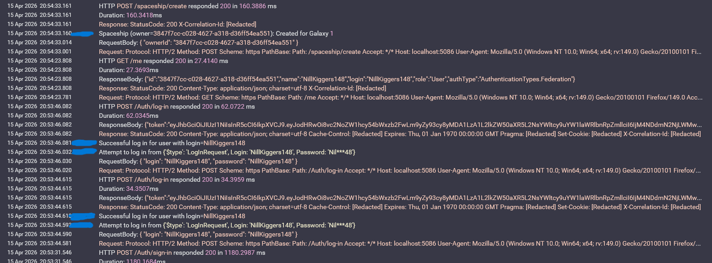

## Что сделано

- Прикручен и сконфигурирован **Serilog**
- Добавлен Seq для логов
- Добавлены Prometheus и postgres-exporter для метрик, Grafana для их визуализации

- Добавлен Destructurama.Attributed для скрытия важных данных. Поля, которые надо скрыть, просто помечаются аттрибутами

- Эндпоинты, где есть логгирование:
    - auth/sign-in
    - auth/log-in
    - player/new-name
    - [delete] player
    - spaceship/create
    - spaceship/move

те, что помечены синим - мои

- Все http-запросы и ответы логгируются через SerilogRequestLogging и встроенный HttpLogging

- Прочее:
    - Прикрутил Carter
    - Auth-эндпоинты сделал через контроллеры, ибо делать семестровку через них я не хочу, зато сейчас я технически использовал их в домашке